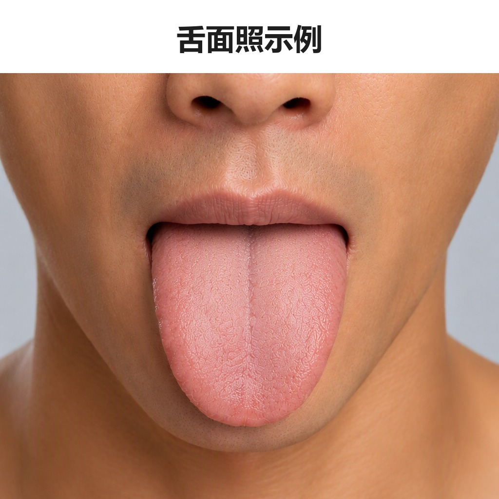
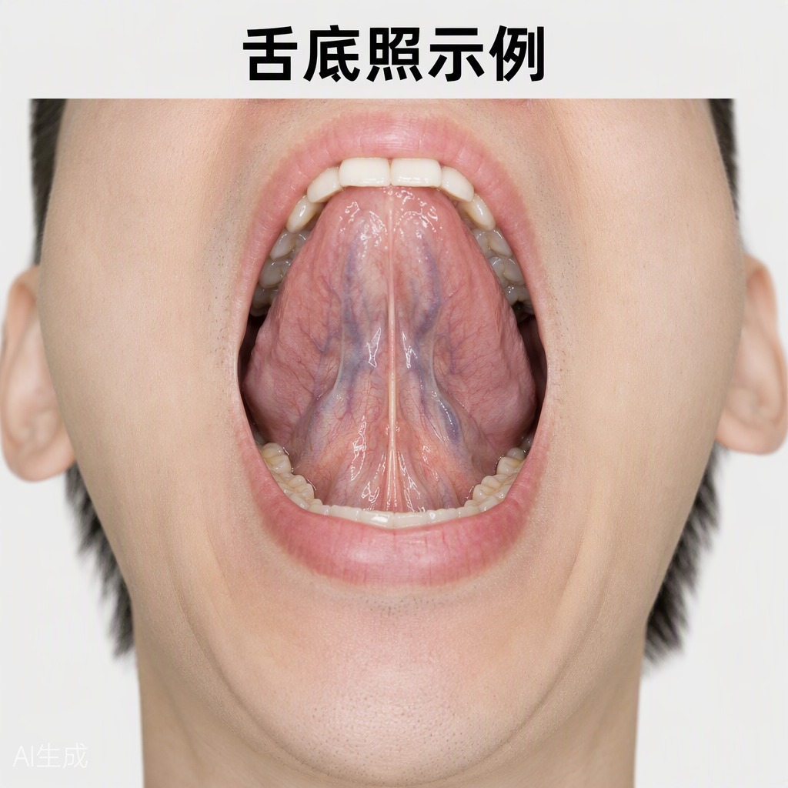
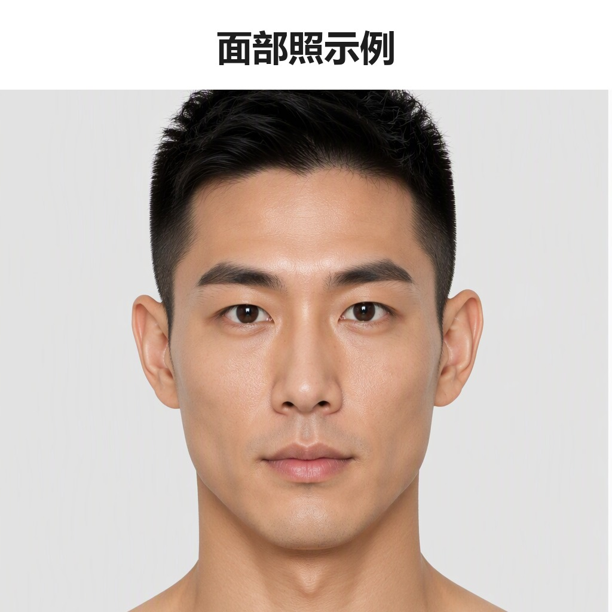
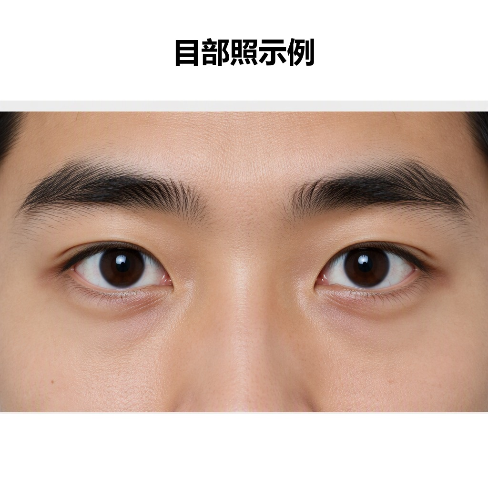
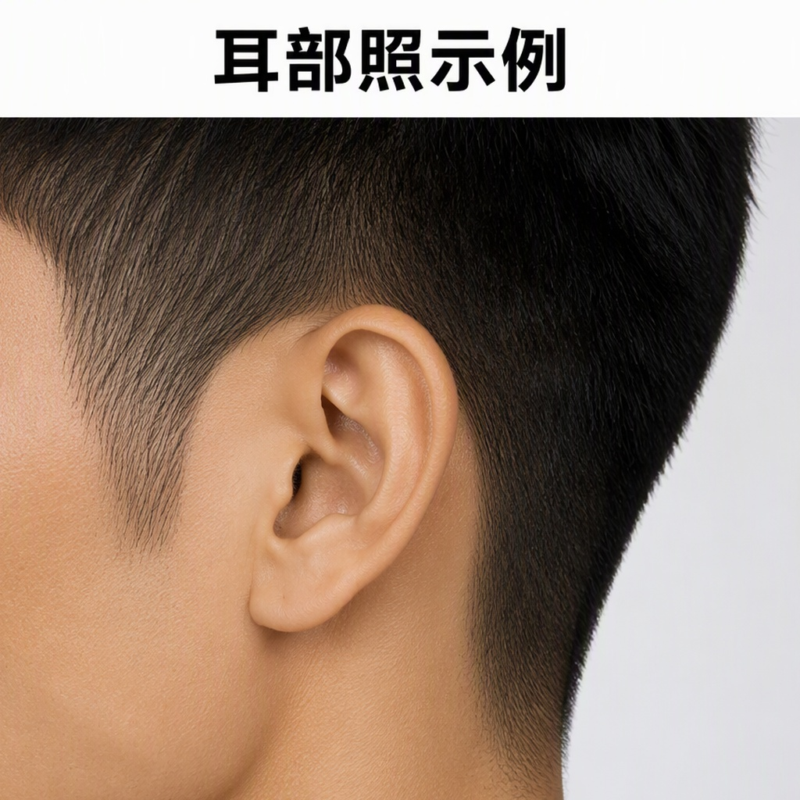
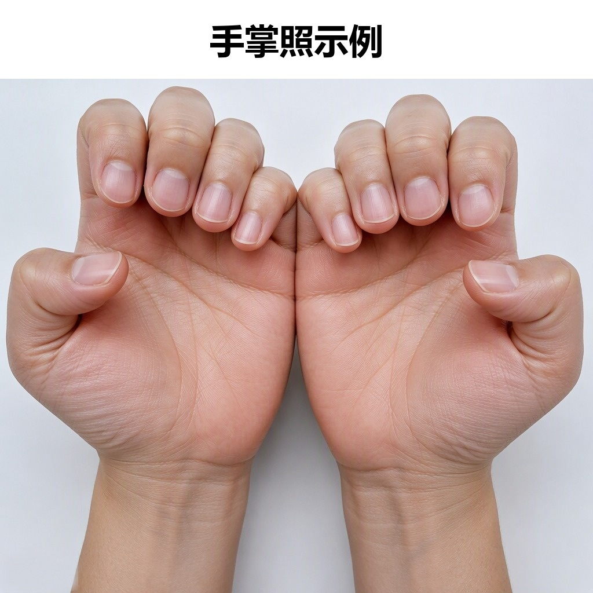
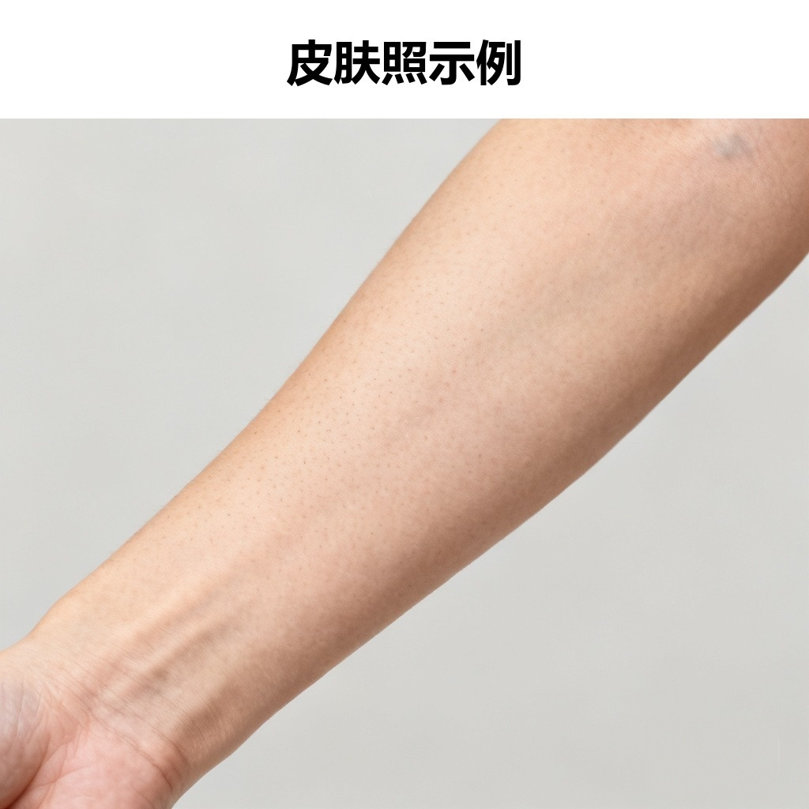

# 中医望诊系统使用手册

版本与变更记录见根目录的 `VERSION` 和 `CHANGELOG.md`。识图模型支持任意 OpenAI 兼容的多模态模型，默认配置在 `.env.example`，更换模型与重新标定的方法见 README 的「配置自己的视觉模型」一节。

---

## 系统简介

本系统以手机摄像头采集望诊影像：按向导依次拍摄舌面、舌底、头面、目、耳、手掌、皮肤七个部位，由视觉模型识别照片中的体征，依据经方体系（三观→四证→六经）完成辨证，输出评分与报告。全部数据仅保存在本机，不上传。

拍摄覆盖的维度数决定辨证输出的置信度等级：

- 仅 1 个部位：只给鉴别方向，不出方（LOW）
- 2~3 个部位：给方剂类别（MEDIUM）
- 4 个及以上：给出具体方剂与剂量（HIGH）
- 问诊为可选补充，在同一置信度等级内提高判断精度；不填写亦可正常运行

总体原则：能拍的部位拍照，拍不了的部位以问诊补充，均不强制。

---

## 各部位拍摄规范

### 1. 舌面照

口诀：伸舌自然，光线均匀，对焦清晰。

- 面对自然光或白光，下巴微抬
- 舌头自然伸出，避免用力——用力伸舌会使舌色偏红，影像失真
- 舌尖抵住下唇，舌面摊平
- 手机距口约 20cm，对焦舌面中央
- 拍摄前 15 分钟内勿进食，勿饮咖啡或茶（易染色）

常见拍摄失误有三：伸舌用力过度（舌色偏红绛）、逆光（舌色发暗）、刚饮过热茶（苔被冲刷）。



### 2. 舌底照

口诀：舌尖轻点上颚，充分暴露舌下。

- 头稍后仰，口张开
- 舌尖轻触上颚（上门牙后方），使舌下自然暴露，不必用力顶压
- 手机自下颌下方仰拍，对焦舌下络脉

舌下主要观察络脉：颜色（淡紫/青紫/紫黑）、形态（怒张/细涩）、有无瘀点。



### 3. 头面部照

口诀：正面平视，素颜，自然光。

一张正面照同时覆盖面色、唇、鼻三个观察区域。

- 正对镜头，双眼平视
- 在自然光下拍摄，关闭美颜与滤镜
- 前额、口唇、鼻部须完整入镜
- 请勿化妆——口红与粉底会遮盖真实面色与唇色
- 表情放松，口唇自然闭合

观察内容：面色的寒热倾向（红赤/萎黄/晦暗/黧黑）与光泽、有无浮肿；唇色（淡白/红/深红/紫暗）与润燥；鼻色及鼻翼是否煽动。



### 4. 目部照

口诀：睁大双眼，拍清白睛和下眼睑。

- 双眼正视镜头，自然睁大，不眯不瞪
- 光线均匀落于双眼
- 可用手指轻拉下眼睑，暴露睑结膜颜色
- 手机使用微距模式，或近距离拍摄

观察内容：白睛颜色（目赤程度）、眼睑浮肿、目眶晦暗、巩膜黄染。



### 5. 耳部照

口诀：侧面拍，耳朵完整入镜。

- 头向一侧转约 90°，完整暴露外耳
- 手机自正侧面拍摄，对焦耳廓
- 光线均匀落于耳部，避免头发或阴影遮挡
- 拍清耳廓颜色、耳轮形态与耳垂

观察内容：耳色（淡白/红赤/青黑）、耳廓润泽或干枯。



### 6. 手掌照

口诀：掌面朝镜头，手指自然微屈，露出指甲。

- 单手（或双手并拢）举于胸前，掌心朝向镜头
- 手指自然微屈，指尖朝向镜头，不要绷直
- 此角度可同时看清掌心与甲床
- 光线自正上方照射
- 单手即可；双手同拍更便于左右对照（推荐）

观察内容：掌色（淡白/红/暗红）、甲床颜色（淡白/红润/暗紫）与形态（光滑/粗糙/甲错）。手的温度无法从影像判读，以问诊补充。



### 7. 皮肤照

口诀：拍前臂内侧或小腿，这些部位少见太阳。

- 选取前臂内侧或小腿前侧
- 如有病灶或异常部位，单独补拍特写
- 光线充足，避免阴影
- 挽起衣袖、裤腿拍摄

观察内容：肤色、有无甲错（干燥粗糙脱屑）、黄汗痕迹、水肿、皮疹。



---

## 问诊十六项

体系设计了 16 项问诊（拍照向导第 8 步采集，全部可跳过；首项「手足温凉」为必答推荐）。问诊不改变置信度等级，只在同一等级内提高判断精度（记录模型仍会统计问诊覆盖，趋势页可见）。问卷内容如下：

| # | 问诊项 | 选项 |
|---|--------|------|
| 1 | 恶寒还是恶热？ | 恶寒 / 恶热 / 往来寒热 / 都不明显 |
| 2 | 有汗无汗？ | 有汗 / 无汗 |
| 3 | 头痛身痛？ | 无 / 头痛 / 身痛 / 头项强痛 |
| 4 | 口苦？ | 无 / 晨起口苦 / 全天口苦 |
| 5 | 咽干？ | 无 / 轻微 / 明显 / 咽干欲饮 |
| 6 | 目眩？ | 无 / 头晕 / 目眩（天旋地转） |
| 7 | 口渴？ | 口不渴 / 口渴欲饮 / 渴不欲饮 / 口燥但欲漱水不欲咽 |
| 8 | 食欲？ | 正常 / 纳呆不食 / 饥不欲食 / 消谷善饥 |
| 9 | 大便？ | 正常 / 便溏 / 便硬 / 便燥 / 下利 |
| 10 | 小便？ | 正常 / 小便清长 / 小便黄赤 / 小便白 / 小便不利 |
| 11 | 睡眠？ | 正常 / 失眠烦躁 / 嗜睡多寐 |
| 12 | 胸胁？ | 无不适 / 胸胁苦满 / 胸闷 |
| 13 | 腹部？ | 无不适 / 腹满 / 腹痛 / 心下痞 |
| 14 | 听力？ | 正常 / 耳鸣 / 听力下降 / 耳无所闻 |
| 15 | 鼻部？ | 正常 / 鼻塞 / 鼻鸣 / 鼻衄 |
| 16 | 汗出时间特征？ | 无异常 / 自汗（白天易汗出）/ 盗汗（睡中汗出）/ 绝汗（大汗淋漓如油） |

填写项越多，判断越准；一项不答系统亦可仅凭影像工作。

---

## 拍摄组合建议

**七张全拍（推荐）**：舌面、舌底、头面、目、耳、手掌、皮肤。六维全覆盖，可达 HIGH，输出具体方剂与剂量。

**拍五张**：舌面、舌底、头面、手掌、皮肤。覆盖四个维度，亦可达 HIGH。

**只拍两张**：舌面加头面。仅覆盖两个维度，系统为 MEDIUM，只给方剂类别方向，不出剂量。

---

## 完整工作流程

1. 在项目根目录运行 `python web/app.py` 启动（依赖安装与初始配置见 [web-quickstart](web-quickstart.md)）
2. 浏览器打开 http://127.0.0.1:8600（手机连接同一 WiFi 的方法见 [web-quickstart](web-quickstart.md) 第六章）
3. 点击顶栏「拍照」进入向导，按舌面→舌底→头面→目→耳→手→皮肤七步逐张拍摄或上传
4. 无法拍摄的部位可选「跳过（声明正常）」或「跳过（未覆盖）」
5. 提交后系统自动完成识图、评分并生成当日记录；若触发危险信号，会先弹出复核提示再入库

辨证报告位于「单日详情」页底部的报告卡片，点「重新生成」可按当前模板重新输出。报告随当日 JSON 一并保存，并记录生成时使用的 `prompt_template_version`。

---

## 辨证报告示例

以下示例取自示例记录 `tests/fixtures/2026-06-25_analysis.json`，为合成数据，无临床含义：

```
🏥 中医望诊辨证报告 — 2026-06-25（合成数据示例）

📊 置信度：🟢 HIGH（照片覆盖 6/6）
   模板版本：prompt_template_version 1.2.0

🔍 经方辨证结论：
   - 三观：表里观→里证为主 | 正邪观→正虚为主 | 津液观→津液不足
   - 四证：水证·轻度 | 火证·轻度 | 气证·轻度 | 血证·轻度
   - 六经归属：示例六经归属（合成数据）
   - 核心病机：示例病机描述（合成数据，无临床含义）

💊 方剂建议（HIGH 置信度）：
   - 示例方（合成数据，12 味）：
     甘草 6g、茯苓 10g、陈皮 6g、山药 10g、莲子 10g、薏苡仁 10g、
     桔梗 6g、生姜 3g、大枣 10g、白扁豆 10g、芡实 10g、砂仁 3g
   - 方义：健脾化湿、和中养胃（合成数据，无临床含义）
   - ⚠️ 剂量仅供参考，请在执业中医师指导下使用
```

---

## 注意事项

**安全提示。** 本系统为辅助参考工具，不构成医疗诊断，所有方剂建议须经执业中医师审核后方可使用。出现以下体征请直接就医，不必拍照：

- 面色红如妆 + 手脚冰凉（戴阳危症）
- 舌体短缩强硬 + 言语不利（中风先兆）
- 极度消瘦 + 舌面光滑无苔（重症消耗）
- 巩膜黄染 + 皮肤黄如橘皮（急性肝胆重症）

**拍摄习惯。** 使用后置主摄；关闭美颜滤镜；尽量采用自然光、避免强光直射；持机保持稳定。

**以下体征的模型识图结果不可直接采信，须当场肉眼复核后再签认：**

| 体征 | 须肉眼复核的原因 | 复核难度 |
|---|---|---|
| 点刺/芒刺 | 凸起度在平面照片上难以判定，实测模型系统性偏向判「有」（同一张舌照 9/9 误判），已退出评分层，档案值仅供辨证参考 | 中——近看舌尖舌边有无凸起的红色颗粒 |
| 腻腐（腻苔） | 模型在「无/微腻/腻」之间抖动（实测三组全抖），直接影响「湿」的方向 | 易——苔面是否黏腻、能否刮下，肉眼或刮苔即判 |
| 齿痕 | 实测抖动（2026-09-18 实验 1：temp=0 组 10 次中 7 次「无」3 次「轻度」，评分在 0/4 之间摆动；temp=1.0 组 10 次全「无」） | 易——对镜张口看舌边压痕 |
| 厚薄 | 实测抖动（同实验 temp=0 组 10 次中 8 次「稍厚」2 次「薄」，评分 3/0 摆动；temp=1.0 组评分层稳定） | 易——苔厚苔薄肉眼直观 |

以下几项识图较为稳定，抽查即可：舌色、苔色、剥落、裂纹、舌下络脉（实验 1 两组共 20 次全部一致）。

「润燥」属措辞抖动（`润` / `润泽` 随机出现，偶见一次 `偏干`），但这几种措辞在评分层同为 0 分，不影响评分，无须复核。

另有三点说明：

- 舌面识图会额外输出 `点刺依据` 字段（一句话说明凸起程度与分布），供肉眼复核参考。按「值禁判读注记」的档案铁律，该字段不写入档案体征值；如需保留，请写入 `lessons` 或 `*_note` 字段。
- 点刺已退出评分层（`prickles` 不参与偏离度计算），因此历史记录的偏离度与当前版本不可直接比较（历史不追溯）。
- `records/_backup/` 内含真实病案与姓名，已在 `.gitignore` 排除。请勿使用 `git add -A` 全量暂存——pre-push 守卫会拦截，但不应依赖其兜底。

---

> 「病随机转，方从法出；以法统方，以平为期。」——经方经典
